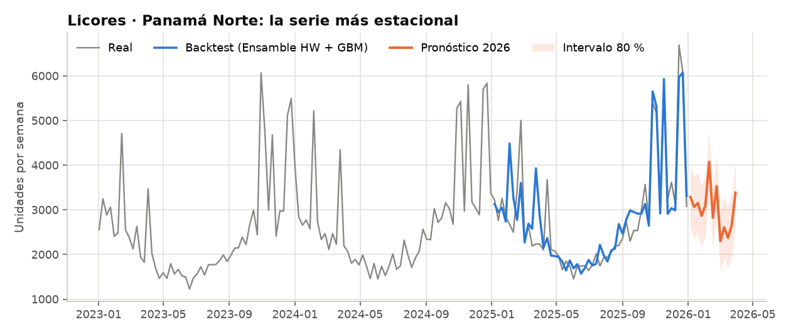
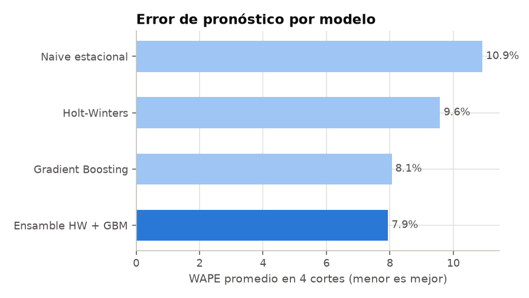
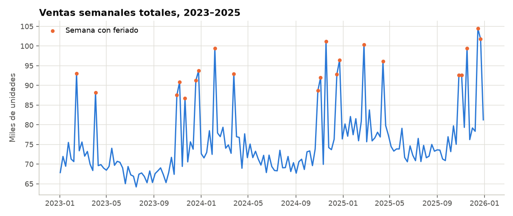

# Pronóstico de demanda para retail

Sistema de pronóstico semanal para una cadena de supermercados: compara modelos estadísticos y de machine learning con **backtesting de origen móvil** y convierte el pronóstico en un **plan de pedidos con stock de seguridad**.


> Datos **sintéticos** de una cadena ficticia: 3 tiendas × 4 categorías, 157 semanas (2023–2025), con estacionalidad, crecimiento, promociones y feriados panameños (Carnaval, Semana Santa, Fiestas Patrias y Navidad).

## Resultado

| Modelo | WAPE | Sesgo |
|---|---:|---:|
| Naive estacional (línea base) | 10,9 % | −4,3 % |
| Holt-Winters | 9,6 % | −1,3 % |
| Gradient Boosting | 8,1 % | −0,9 % |
| **Ensamble HW + GBM** | **7,9 %** | −1,1 % |

El ensamble reduce el error un **27 %** frente a repetir las ventas del año anterior.



| | |
|---|---|
|  |  |

## Qué incluye

- **Tres enfoques de pronóstico**: naive estacional, Holt-Winters amortiguado con estacionalidad multiplicativa (statsmodels) y un **modelo global** de Gradient Boosting entrenado con las 12 series a la vez.
- **Ingeniería de variables sin fugas de datos**: rezagos de 13 o más semanas y calendario (semana del año en seno y coseno, feriados, promociones). Permite pronosticar 13 semanas en forma directa, sin recursión.
- **Backtesting de origen móvil**: 4 cortes consecutivos, cada uno entrena con el pasado y pronostica el trimestre siguiente.
- **WAPE y sesgo** como métricas: más robustas que MAPE cuando hay semanas de baja venta.
- **Plan de pedidos**: pronóstico de 13 semanas más stock de seguridad (95 % de servicio, σ del error de backtest y 2 semanas de reposición).

Reporte completo con el plan de pedidos: [REPORTE.md](REPORTE.md). Salidas en [`resultados/`](resultados).

## Cómo ejecutarlo

```bash
pip install -r requirements.txt
python -m demanda.datos       # genera datos/ventas_semanales.csv
python -m demanda.backtest    # backtest, pronóstico, plan de pedidos, gráficos y REPORTE.md
pytest
```

## Estructura

```
demanda/     datos.py · modelos.py · backtest.py
resultados/  métricas del backtest, pronóstico de 13 semanas y plan de pedidos (CSV)
graficos/    gráficos generados
tests/       pytest
```
