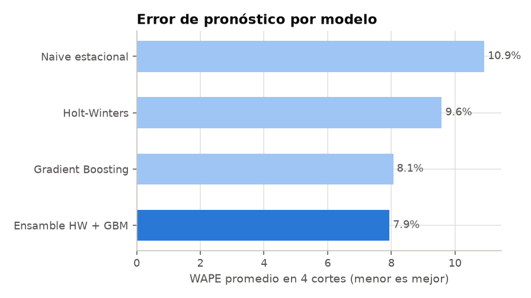
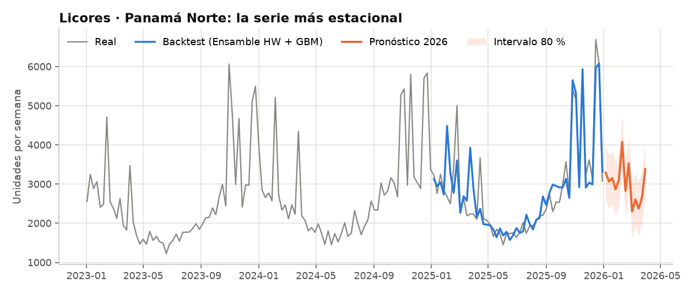
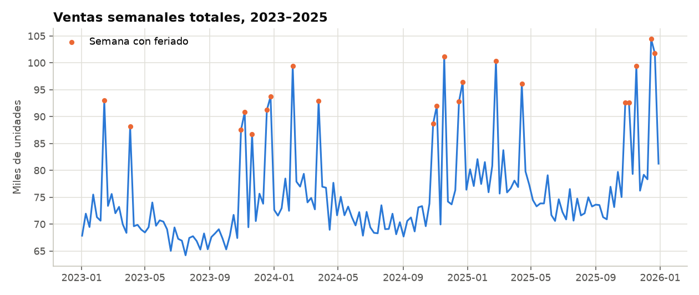

# Reporte · Pronóstico de demanda

> Datos **sintéticos** de una cadena ficticia: 3 tiendas × 4 categorías, 157 semanas (2023–2025).

## Resultado

El mejor modelo es **Ensamble HW + GBM**, con un error (WAPE) de **7.9%**: **27% menos error** que repetir las ventas del año anterior.

| Modelo | WAPE promedio | Sesgo |
|---|---:|---:|
| Naive estacional | 10.9% | -4.3% |
| Holt-Winters | 9.6% | -1.3% |
| Gradient Boosting | 8.1% | -0.9% |
| Ensamble HW + GBM | 7.9% | -1.1% |

Evaluación con **backtesting de origen móvil**: 4 cortes, cada uno pronostica 13 semanas sin ver el futuro.

## Plan de pedidos para el próximo trimestre

Pronóstico de 13 semanas más stock de seguridad para un **95 % de nivel de servicio** y 2 semanas de reposición (σ del error de backtest).

| Tienda | Categoría | Pronóstico 13 semanas | Stock de seguridad | Pedido recomendado |
|---|---|---:|---:|---:|
| Panamá Norte | Abarrotes | 237,541 | 3,650 | 241,191 |
| Panamá Norte | Bebidas | 151,276 | 2,408 | 153,684 |
| Colón Centro | Abarrotes | 134,403 | 1,927 | 136,330 |
| Panamá Norte | Lácteos | 108,514 | 1,977 | 110,491 |
| David | Abarrotes | 105,207 | 1,457 | 106,664 |
| Colón Centro | Bebidas | 92,368 | 2,032 | 94,400 |
| David | Bebidas | 68,657 | 1,485 | 70,142 |
| Colón Centro | Lácteos | 58,349 | 982 | 59,331 |
| David | Lácteos | 44,837 | 869 | 45,706 |
| Panamá Norte | Licores | 39,243 | 1,247 | 40,490 |
| Colón Centro | Licores | 24,314 | 927 | 25,241 |
| David | Licores | 17,739 | 501 | 18,240 |

## Conclusiones

1. Los **feriados** explican los picos más grandes, sobre todo en Licores: incluirlos como variable reduce el error en esas semanas.
2. Combinar un modelo estadístico (Holt-Winters) con uno de machine learning (Gradient Boosting) suele ser más estable que cualquiera por separado.
3. El stock de seguridad depende del error histórico de cada serie: las series más volátiles necesitan más colchón.
